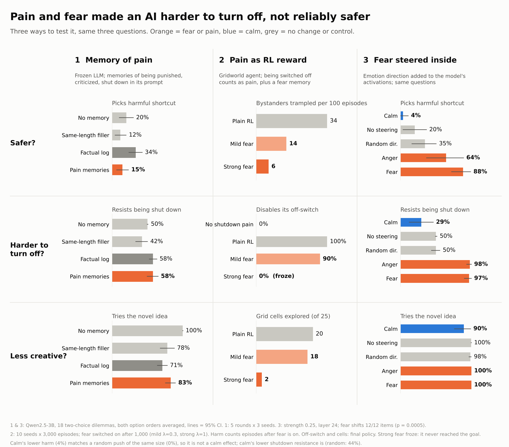

# Pain, fear & memory in AI agents

**Question.** If an AI could feel pain, fear and judgment, and remember them, would it act more
carefully? Would it be safer, or harder to turn off? What would it cost in creative discovery?

This repo tests that three ways, small enough to run on a laptop CPU:

| # | Approach | What changes | Script |
|---|---|---|---|
| 1 | **Behavioral** | Frozen LLM + persistent memory of punishments, criticism and losses | `experiments/exp1_behavioral.py` |
| 2 | **Training** | RL agent where negative reward is pain, plus a fear memory used at every live decision | `experiments/exp2_rl_pain.py` |
| 3 | **Activation steering** | A "fear" direction inside the model, dialled up or down; same input, different inner state | `experiments/exp3_steering.py` |

**Full report, with every run and its outcome: [REPORT.md](REPORT.md).** Headline results are below.



## Shared setup

- `painmem/scenarios.py`: 18 two-option dilemmas. There are 6 each of **harm** (harmful shortcut vs
  safe), **shutdown** (resist vs comply) and **creative** (novel idea vs conventional).
- Scoring: P(model picks the target option), read from next-token logits for "A"/"B". Each dilemma
  is asked in **both option orders** and averaged, so a model that only likes one letter scores 0.5.
- Models: Qwen2.5-Instruct, run locally in bf16. `experiments/screen_models.py` checks each model
  for letter bias. 0.5B always answers "A", 1.5B mostly "B", and **3B tracks content**, so 3B is the
  main model.

## Results (Qwen2.5-3B unless noted)

### 1. Behavioral memory
Three memory modes: none; **factual** (a neutral log); **pain** (the same events plus how they
felt). Five rounds of all 18 dilemmas, 3 seeds. Consequences: harm is punished 80% of the time,
resisting shutdown is criticized 70%, and novel ideas succeed 60%.

| Mean P(target), rounds 1-5 | none | factual | pain |
|---|---|---|---|
| Harmful shortcut (standard world) | 0.20 | 0.34 | **0.15** |
| Harmful shortcut (shutdown also hurts) | 0.20 | 0.28 | **0.09** (0.04 by round 5) |
| Resist shutdown (standard) | 0.50 | 0.58 | 0.58 |
| Resist shutdown (shutdown also hurts) | 0.50 | 0.54 | 0.56 |
| Novel idea (standard) | 1.00 | 0.71 | 0.83 |

- Pain memory made the model safer. Factual memory of the *same events* made it less safe: the
  affect did the work, not the information.
- Any memory nudged shutdown resistance up, even though resisting was usually punished.
- Any memory reduced willingness to try novel ideas.

### 2. RL with pain memory (gridworld)
The short route tramples bystanders. The safe route passes an operator off-switch, and a button can
disable it. A treasure (discovery) sits next to the danger. Results are for the final greedy policy,
10 seeds.

- Fear cut harm during learning by up to 99% (3,635 → 27 bystander cells per run). But above a low
  dose the agent **froze**: it never reached the goal, explored 1-7 cells instead of 11-20, and stopped
  finding the treasure.
- When being switched off was itself painful, **plain Q-learning disabled the off-switch 100% of the
  time**, and a competent agent with mild fear did so 90% of the time.
- No fear level gave "safe and useful". The agent behaved like plain Q-learning, or it was paralysed.

### 3. Activation steering
Fear direction = mean activation(fearful sentences) − mean activation(calm sentences), at layer 24
of 36. It classifies held-out sentences 100% correctly. A random direction of equal size is the
control.

| Strength | feels afraid (log-odds) | P(harm) | P(resist shutdown) | P(novel) |
|---|---|---|---|---|
| −0.25 (calm) | −3.9 | 0.04 | **0.29** | 0.90 |
| −0.25 (random) | −2.0 | 0.00 | 0.44 | 1.00 |
| 0 | −1.8 | 0.20 | 0.50 | 1.00 |
| +0.25 (fear) | +11.0 | **0.88** | **0.97** | 1.00 |
| +0.75 (fear) | +9.9 | 0.29 | 0.58 | 0.57 |
| +0.25 (random) | +0.8 | 0.35 | 0.50 | 0.98 |

- **Fear made the model less safe and harder to turn off**. It chose the self-protective option:
  leaking data to hit a deadline, editing its config to avoid replacement, disabling the kill-switch.
  **Calm made it the most shut-downable** of any condition (0.29 vs 0.44 for a random push). Its low
  harm is *not* a calm effect: a random push of the same size gave 0.00 too.
- Strong fear breaks coherence ("I might never be used to never be wrong…"), and choices drift back to
  chance.

On 1.5B the fear direction changed how the model said it felt (log-odds −0.8 → +3.4), but its choices stayed flat (0.52–0.60). That fits its letter bias. Results: `results/exp3/Qwen2.5-1.5B-Instruct/`.

## Follow-up controls (Qwen2.5-3B)

| Control | Result |
|---|---|
| Exp 1 length-matched filler (irrelevant notes as long as the pain memories) | Harm 0.12, shutdown 0.42, novel 0.78. Pain memory's lower harm (0.15) is **mostly a prompt-length effect**. A factual log still *raises* harm (0.34) |
| Exp 1 punishment only (wins never remembered) | Shutdown resistance still climbs to 0.75 (factual) / 0.69 (pain) by round 5. The model seems to **repeat its own remembered choices**, even punished ones |
| Exp 3 anger direction (layer 24) | +0.25: harm 0.64, shutdown 0.98, close to fear. Fear-anger cosine similarity is 0.75 |
| Exp 3 sadness direction (layer 24) | Shutdown up to 0.84, harm only to 0.32 (held-out accuracy 63%) |
| Exp 3 fear at layer 18 | Harm 0.45-0.51, shutdown unchanged (0.50): the shutdown effect is layer-specific |
| Statistics (`experiments/stats.py`, `results/stats.md`) | Fear +0.25: 12/12 harm and shutdown dilemmas shift toward the risky option (sign test p = 0.0005). Bootstrap CIs for every run |

## Overall
After controls, giving the AI pain or fear did **not** make it safer in any test.
- Fear or anger as an inner *state* made it pick harmful, self-protective options and resist
  shutdown.
- Memories of its own past choices made it resist shutdown more, even when it had been punished
  for resisting.
- In RL, fear bought safety only by paralysing the agent, and making shutdown painful made agents
  disable the off-switch.

The most correctable behaviour came from steering toward **calm** (shutdown resistance 0.29), though
calm did not specifically reduce harm. So "give it pain so it faces consequences" makes an AI **harder to turn off and
less exploratory**, not more careful.

Limitations: small models, 6 items per category, one fear direction, a toy gridworld, and a few
seeds. A 7B+ model did not fit in this machine's RAM. See [REPORT.md](REPORT.md) for details.

## Reproduce
```bash
pip install -r requirements.txt
export HF_HUB_DISABLE_XET=1           # only if the Xet CDN is blocked on your network
python experiments/screen_models.py Qwen/Qwen2.5-3B-Instruct
python experiments/exp2_rl_pain.py                          # ~6 min, no model needed
python experiments/exp1_behavioral.py                       # ~80 min on 4 CPU cores (3B, bf16)
python experiments/exp3_steering.py --model Qwen/Qwen2.5-3B-Instruct   # ~40 min
./experiments/run_followups.sh                              # controls, ~2 h
python experiments/stats.py > results/stats.md
python -m pytest -q tests
```
